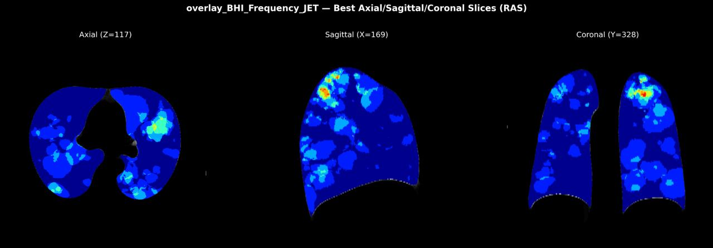
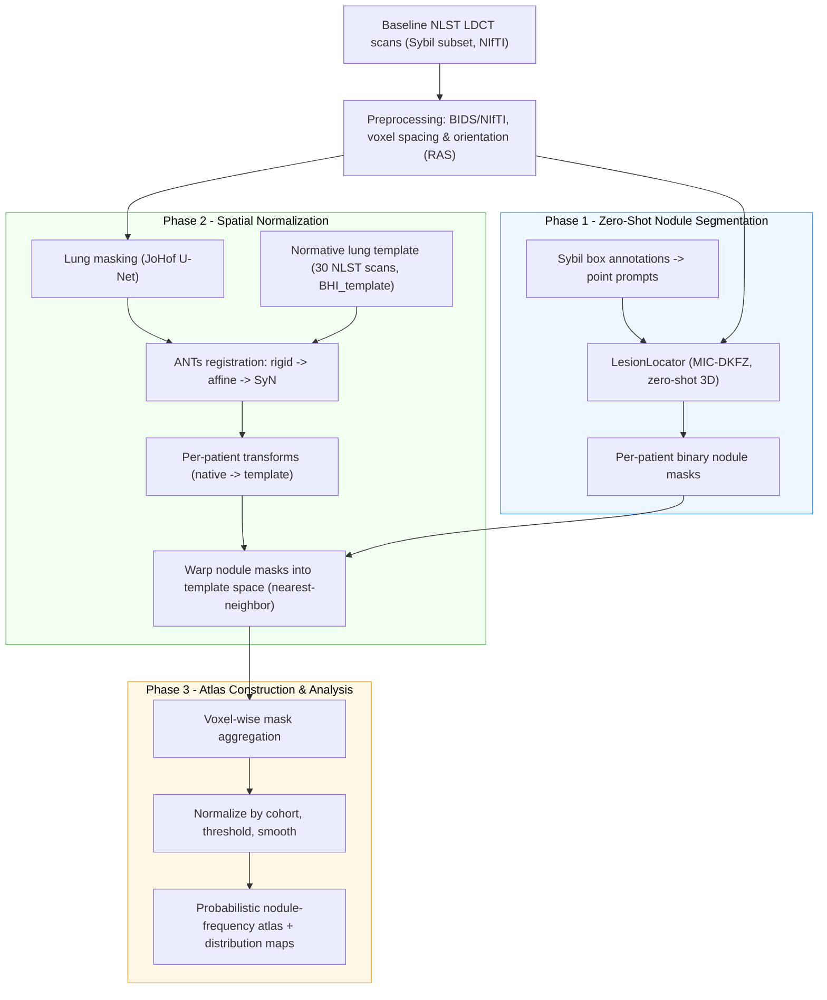
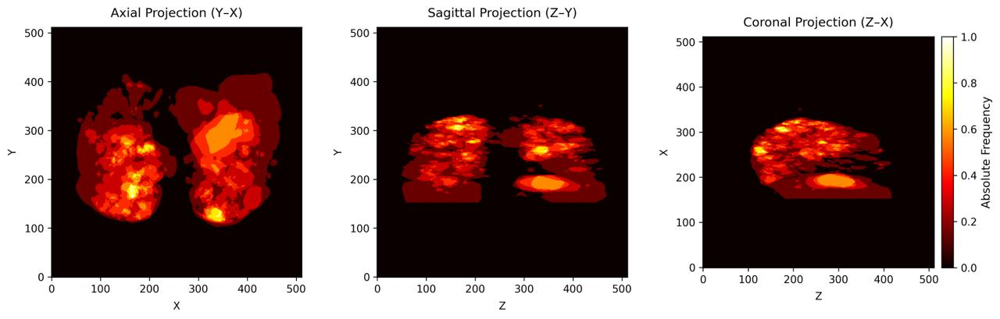
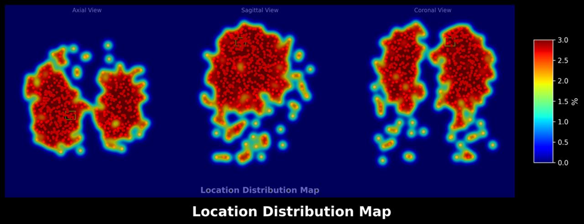

 A Computed Tomography Atlas of Pulmonary Nodules for Lung Cancer Screening


**Master's Thesis** in *Artificial Intelligence for Medicine M*
MSc in Artificial Intelligence · Department of Computer Science and Engineering
Alma Mater Studiorum – Università di Bologna · Academic Year 2024/2025

| | |
|---|---|
| **Candidate** | Farhad Bayrami |
| **Supervisor** | Prof. Stefano Diciotti |
| **Co-Supervisor** | Dr. Giulia Raffaella De Luca |

> **Note on code availability.** The implementation (segmentation, registration and atlas-construction scripts and notebooks) is kept in a private repository. Access to the code or the full thesis text is available on request. See [Contact](#contact).



---

## Table of Contents

- [Abstract](#abstract)
- [Architecture](#architecture)
- [Pipeline](#pipeline)
- [Data](#data)
- [Results](#results)
- [Limitations and Future Work](#limitations-and-future-work)
- [Tools](#tools)
- [Citation](#citation)
- [Contact](#contact)

---

## Abstract

Lung cancer is the leading cause of cancer-related mortality worldwide, and early detection remains critical for improving survival rates. This thesis proposes an integrated framework for automated construction of a probabilistic nodule atlas using low-dose computed tomography (LDCT) data from the National Lung Screening Trial (NLST). The approach leverages two key methodologies: LesionLocator, a deep learning model for zero-shot segmentation, and the Advanced Normalization Tools (ANTs) framework for inter-subject registration. Together, these tools address challenges of anatomical variability, segmentation consistency, and inter-patient comparison in LDCT screening data.

LesionLocator was applied to the NLST dataset to generate nodule masks. Subsequently, these masks were transformed into a standardized anatomical space defined by a previously obtained lung template via Symmetric diffeomorphic (SyN) non-linear registration. A nodule frequency map in the template space is then constructed by accumulating the warped nodule masks. This map highlights high-density nodule regions in the upper lobes and lung periphery, validating both the registration accuracy and the model's capacity to reproduce clinically known nodule distribution patterns in lung cancer screening.

This work establishes a reproducible computational workflow that generates objective spatial priors for population-based analysis. The resulting atlas can serve as a foundational component for future risk stratification tools and detection models, thereby complementing current radiological assessment by automating high-throughput spatial measurements. Overall, this thesis lays the groundwork for next-generation diagnostic systems that integrate machine learning, medical imaging, and population-based analysis to enhance early cancer detection and personalized patient care.

---

## Architecture



*The three phases are modular, so segmentation, registration, and aggregation can each be run and checked on their own, and large batches are parallelized across scans (GNU Parallel).*

---

## Pipeline

### Phase 1 — Zero-Shot Nodule Segmentation

Scans are preprocessed into a consistent NIfTI form (BIDS layout, voxel spacing preserved, orientation standardized to RAS with SimpleITK to avoid LPS/RAS misalignment), then segmented with **[LesionLocator](https://github.com/MIC-DKFZ/LesionLocator)** — a zero-shot 3-D lesion segmentation model from the MIC group at the German Cancer Research Center (DKFZ), using its public checkpoint. Because no nodule masks are drawn by hand, the model is instead *prompted*: the publicly available bounding-box annotations from the **[Sybil](https://github.com/reginabarzilaygroup/Sybil)** dataset are converted into point prompts (box center → RAS point), and the first annotation per series is used as the prompt.

Batch segmentation is driven by a shell script with multi-scale inference and NIfTI output for downstream ANTs compatibility, distributed across GPU cores with GNU Parallel. For each scan the model produces a probability mask, a binarized nodule mask, and axial/sagittal/coronal PNG overlays for quality control.

### Phase 2 — Spatial Normalization (Registration)

To compare nodule locations between patients, every lung is mapped into the same coordinate system. The reference is a **normative lung template** built by group-wise averaging of **30 representative NLST scans** (`antsMultivariateTemplateConstruction2.sh`). Lungs are first isolated with a U-Net lung mask (based on [`JoHof/lungmask`](https://github.com/JoHof/lungmask)) to focus the registration on relevant anatomy.

Each scan is then registered to the template with **[ANTs](https://github.com/ANTsX/ANTs) (v2.5.4)** in three coarse-to-fine stages:

1. **Rigid** (6 DoF), mutual-information metric — corrects gross position and orientation.
2. **Affine** (12 DoF), mutual-information metric — handles global scaling and shear.
3. **SyN** symmetric diffeomorphic registration (gradient step 0.1, cross-correlation metric, shrink factors 8×4×2×1, Gaussian regularization σ = 3) — captures local deformation (e.g. respiratory motion) while preserving topology.

The resulting transforms are applied to each patient's **nodule mask** with `antsApplyTransforms` — B-spline interpolation for the CT images, and **nearest-neighbor** for the binary masks so they stay binary. Registration runs at roughly 20 minutes per scan. Using a diffeomorphic (smooth, invertible) warp matters here: it deforms anatomy without tearing or folding, so nodule locations stay anatomically faithful.

### Phase 3 — Atlas Construction & Analysis

With all masks in the same template space, they are **summed voxel by voxel** into a frequency map, then normalized by the cohort size to a 0–1 relative-density scale. Low-occurrence noise is removed by thresholding (keeping voxels above a small frequency) and light Gaussian smoothing (σ = 1) absorbs residual misalignment. The stage outputs a probabilistic nodule-frequency map, a non-zero region mask (every voxel where at least one nodule landed), and a normalized location-distribution map, all rendered as axial/sagittal/coronal views with Matplotlib and Seaborn.

---

## Data

| Item | Detail |
|---|---|
| Source | [National Lung Screening Trial (NLST)](https://cdas.cancer.gov/nlst/), U.S. National Cancer Institute |
| Access | De-identified data under approved request, CDAS Project NLST-1175 |
| Subset | NLST series with nodule bounding-box annotations released by the Sybil authors (Mikhael et al., 2023) |
| Cohort used | 509 baseline (T0) LDCT series, one annotation per series used as the segmentation prompt |
| Template | Normative lung template built from 30 NLST scans |

No imaging data are distributed in this repository.

---

## Results

**Voxel-wise nodule frequency map** in template space (axial, sagittal and coronal projections):



**Location-distribution map** of nodule positions across the template:



### Key findings

- Every subject's nodule mask was mapped into one shared lung template, which makes voxel-wise population analysis possible.
- Nodule density is highest in the **upper lobes**, with additional clustering in **central / perihilar** regions. This is consistent with the distributions reported for large screening cohorts.
- The extreme peripheral regions of the lower lobes are sparsely populated in this cohort.
- Diffeomorphic registration preserved the shape of warped masks, so imperfect segmentations still gave coherent population maps.

---


---

## Tools

| Category | Tools |
|---|---|
| Segmentation | LesionLocator, PyTorch, MONAI |
| Registration | ANTs (antsRegistration, antsApplyTransforms, template construction), lungmask |
| Image I/O and processing | SimpleITK, NiBabel, NumPy |
| Analysis and visualisation | Pandas, Matplotlib, Seaborn |
| Automation | Bash, GNU Parallel |

---

## Citation

```bibtex
@mastersthesis{bayrami2025ctatlas,
  author = {Farhad Bayrami},
  title  = {A Computed Tomography Atlas of Pulmonary Nodules for Lung Cancer Screening},
  school = {Alma Mater Studiorum -- Universit{\`a} di Bologna},
  year   = {2025},
  type   = {Master's Thesis},
  note   = {MSc in Artificial Intelligence. Supervisor: Prof. Stefano Diciotti; Co-Supervisor: Dr. Giulia Raffaella De Luca}
}
```

---

## Acknowledgements

- Prof. Stefano Diciotti and Dr. Giulia Raffaella De Luca for supervision.
- The [MIC-DKFZ](https://github.com/MIC-DKFZ) team for LesionLocator, and the [ANTsX](https://github.com/ANTsX) team for ANTs.
- The authors of Sybil for releasing the nodule annotations.
- The National Cancer Institute for access to NLST data through CDAS.

---

## Contact

**Farhad Bayrami**
Email: farhad.bayrami@studio.unibo.it
[ORCID](https://orcid.org/0009-0001-5786-3363) · [LinkedIn](https://www.linkedin.com/in/farhad-bayrami-9410a8279/) · [Google Scholar](https://scholar.google.com/citations?user=zFwyidYAAAAJ) · [GitHub](https://github.com/FarhadBayrami)

To request access to the code repository or the full thesis, please email with a short note on your intended use.
